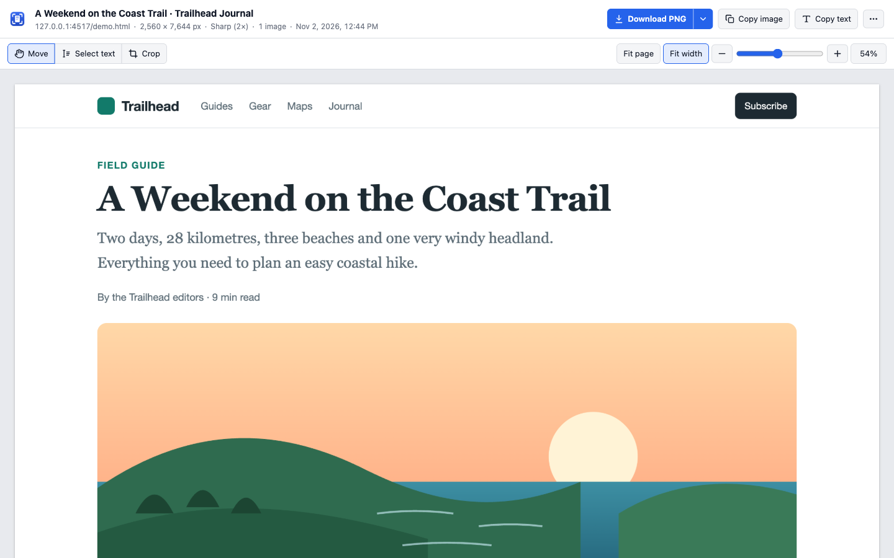
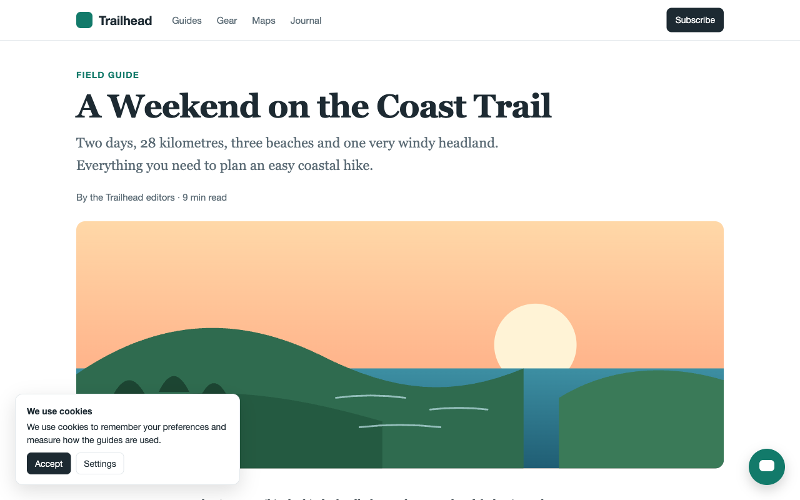
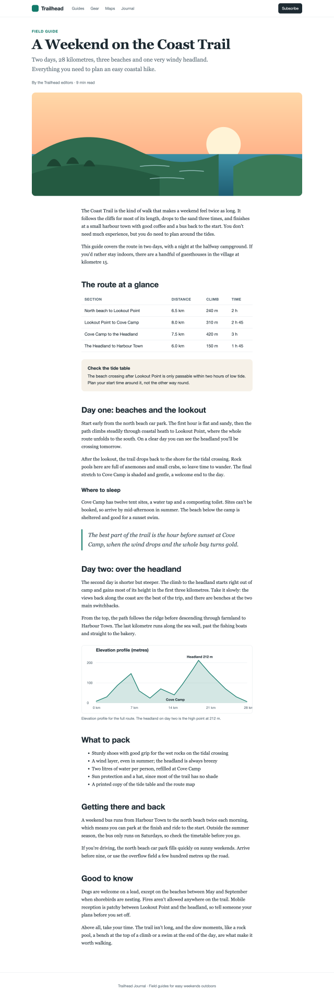
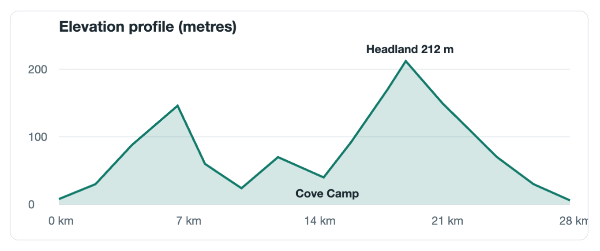
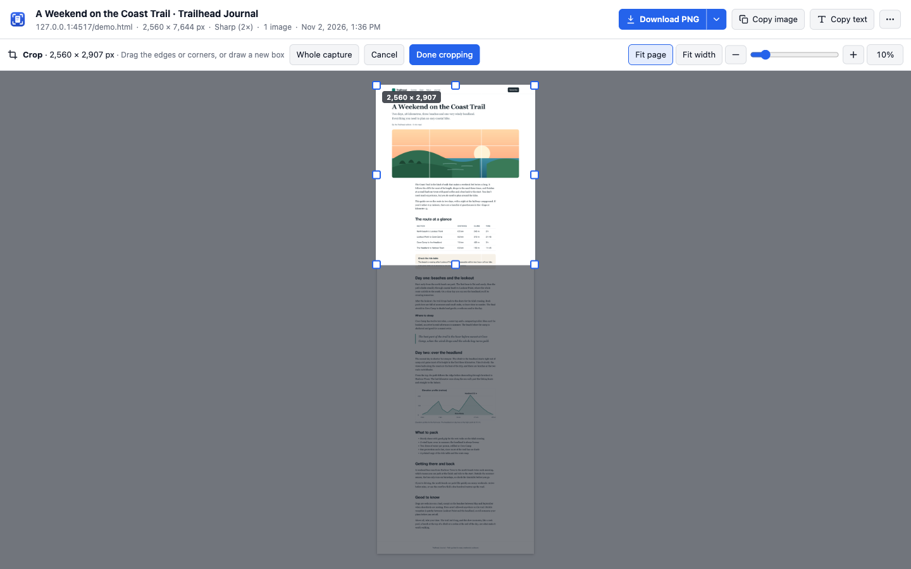
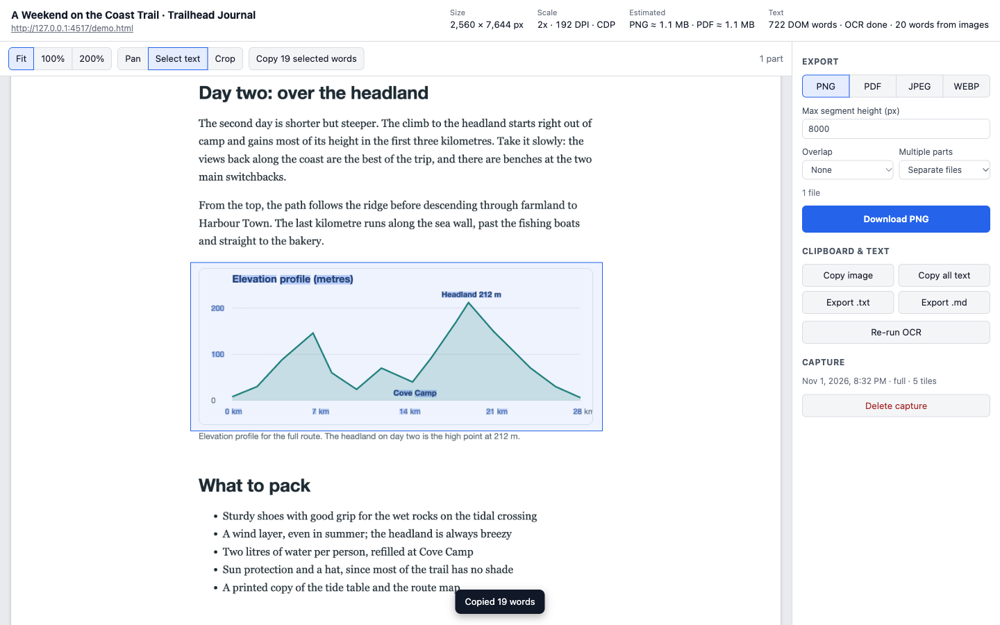
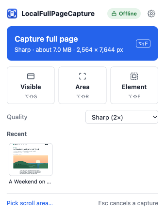
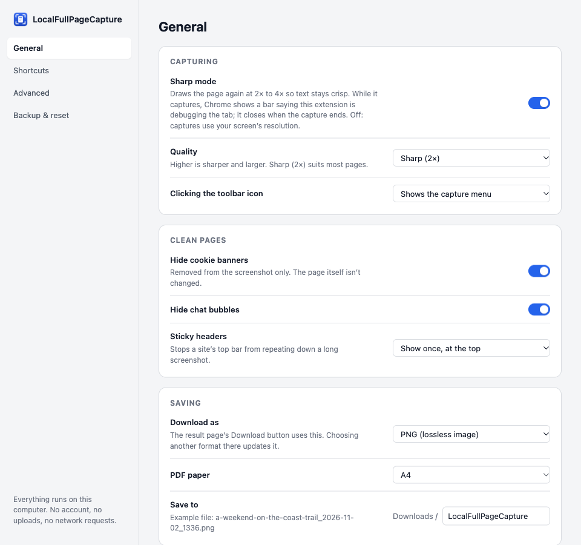
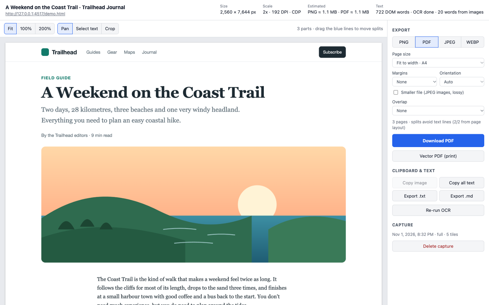

# Hushshot

*Formerly LocalFullPageCapture.*

**🌐 Website: [hushshot.app](https://hushshot.app/)** · [Download](https://github.com/varunshinde/Hushshot/releases/latest/download/Hushshot.zip) · [Help](https://hushshot.app/help.html) · [Privacy policy](https://hushshot.app/privacy.html)

**Pixel-sharp full-page screenshots, searchable PDFs and on-device OCR for Chrome. Nothing ever leaves your computer.**

Hushshot is a private, offline screenshot extension (Manifest V3). It captures entire web pages at up to 4× resolution, exports lossless PNGs and PDFs you can search and select text in, and pulls the text out of everything, including images and charts. It makes no network requests at all: no analytics, no accounts, no cloud.

<p align="center">
  
</p>

## Why Hushshot

| | |
|---|---|
| 🔍 **Pixel-sharp** | Re-renders the page at 2×, 3× or 4× instead of upscaling, so text stays crisp when you zoom in. No seams, no duplicated rows. |
| 🧹 **Clean output** | Hides scrollbars, shows sticky headers once, waits for lazy images and can remove cookie banners and chat bubbles. |
| 📄 **Searchable PDFs** | Every PDF has an invisible text layer, so you can search, select and copy text in any PDF viewer. |
| 🔤 **Text from anything** | Exact text from the page, plus offline OCR for images, canvas charts and video frames. |
| 🔒 **Private by design** | Zero network requests, no remote code, minimal permissions. Everything is bundled, including the OCR model. |

## What it looks like

### Capture the whole page, cleanly

Left: the page as you see it, with a cookie banner and a chat bubble. Right: the full-page capture, with the sticky header shown once and the overlays removed.

<p align="center">
  
  &nbsp;
  
</p>

### Real resolution, not upscaling

A 1:1 crop of a 2× capture. The chart is re-rendered at twice the pixel density, so lines and labels stay sharp.

<p align="center">
  
</p>

### Crop with handles, even on very long pages

Click **Crop** and the whole capture fits on screen. Drag the edges or corners, or draw a new box; drag to the edge of the window and the page scrolls with you. Click **Done cropping**, and every download and copy uses just that area.

<p align="center">
  
</p>

### Copy text, even from images

Switch to **Select text** and drag a box. This chart is a `<canvas>`, so its labels aren't real text, but on-device OCR reads them and the 19 words are copied.

<p align="center">
  
</p>

### Simple popup, simple settings

One big button for the full page; Visible, Area and Element next to it. Settings shows the everyday choices first, and every fine-tuning option lives under **Advanced**.

<p align="center">
  
  &nbsp;
  
</p>

### PDFs set up in one panel

Pick **PDF** from the Download menu to choose paper, margins, and whether to print the page address and date on each page.

<p align="center">
  
</p>

> The screenshots are generated automatically from a generic demo page in this repo (`test/fixtures/demo.html`) with `pnpm docs:screenshots`.

## Install

Hushshot is coming to the Chrome Web Store soon. Until then, you load it into Chrome as an unpacked extension, either from a ready-made zip or by building it yourself.

### Option 1: download a release (easiest)

1. Download [`Hushshot.zip`](https://github.com/varunshinde/Hushshot/releases/latest/download/Hushshot.zip) (always the latest version; every version is on the [Releases page](https://github.com/varunshinde/Hushshot/releases)) and unzip it.
2. Optional: check the download. Run `shasum -a 256` on the zip and compare the result with the SHA-256 in the release notes.
3. Open `chrome://extensions` and turn on **Developer mode** (top right).
4. Click **Load unpacked** and choose the unzipped folder.
5. Click the puzzle-piece icon in the toolbar and pin **Hushshot**.

Keep the unzipped folder where it is; Chrome loads the extension from it. To update, download the new release, replace the folder's contents and click the reload arrow on the extension's card.

### Option 2: build from source

**You need:** Google Chrome 120+, [Node.js](https://nodejs.org) 20+ and pnpm 10.

```bash
git clone https://github.com/varunshinde/Hushshot.git
```

```bash
cd Hushshot
```

```bash
npm install -g pnpm@10
```

```bash
pnpm install
```

```bash
pnpm build
```

Then, in Chrome:

1. Open `chrome://extensions` and turn on **Developer mode** (top right).
2. Click **Load unpacked** and choose the `dist/chrome-mv3` folder.
3. Click the puzzle-piece icon in the toolbar and pin **Hushshot**.

Chrome loads the extension from that folder, so keep it where it is. After pulling updates, run `pnpm build` again and click the reload arrow on Hushshot's card in `chrome://extensions`. Your settings and saved captures are kept.

## How to use it

1. Open any web page and click the Hushshot icon, or press a shortcut.
2. Click **Capture full page**, or pick Visible, Area or Element. The toolbar icon shows the progress.
3. The result page opens. Download, copy the image or its text, crop, or zoom in.

| Mode | Shortcut (Mac: Option+Shift) | What it captures |
|---|---|---|
| **Full page** | Alt+Shift+F | The entire scrollable page |
| **Visible** | Alt+Shift+S | What's on screen right now |
| **Area** | Alt+Shift+R | A rectangle you drag. Drag to the edge of the window to keep scrolling |
| **Element** | Alt+Shift+E | One part of the page. Click it, and use ↑/↓ to pick the parent or child |

Press **Esc** to cancel at any time. To change the shortcuts, go to `chrome://extensions/shortcuts`. Prefer one click? Set **Clicking the toolbar icon** to *Captures the full page right away* in Settings.

**Sharp mode** re-draws the page at 2×–4× so text stays crisp. It uses Chrome's *debugger* permission, which is why Chrome's install dialog warns that the extension can "read and change all your data on all websites": the debugger is only attached to the tab you're capturing, only during the capture. While it captures, Chrome shows a bar saying the extension is debugging the tab; it closes when the capture ends. Turn Sharp mode off in Settings to use your screen's resolution instead.

**Pages with their own scroll area** (Gmail, Notion and similar apps) are detected automatically. If the wrong part scrolls, use **Pick scroll area…** in the popup.

**On the result page:** pinch on a trackpad or use the zoom slider, **Fit page** to see everything, **Fit width** to read. Keyboard: ⌘S download, ⌘C copy image, ⌘⇧C copy all text, C crop, T select text. The full list is under Settings → Shortcuts.

### Export options

- **PNG:** lossless, with the correct DPI saved in the file. Long pages split into parts at points that don't cut through text or images, and you can drag the blue break lines yourself.
- **PDF:** fit to A4, Letter or Legal width, or one long page, with searchable text. Every page has the same width, and each page is filled to the bottom with the break placed between lines of text, so lines are never cut and gaps stay small. Optionally print the page address, capture date and page number at the bottom of each page. A **print-style PDF** (real vector text from the open tab) is in the ⋯ menu.
- **JPEG / WebP:** only if you choose them, for smaller files.
- **Text:** copy all text, export `.txt` or `.md` (headings and lists kept), or select an area to copy.

## Privacy

- **No network requests, ever.** The OCR engine, WebAssembly and language model are bundled. The build fails if any remote URL is left in the code.
- **No remote code.** No `eval` and no downloaded scripts. The Content Security Policy is `script-src 'self' 'wasm-unsafe-eval'`.
- **Minimal permissions.** No host permissions: Hushshot only touches a tab when you click its icon or press a shortcut. Sharp mode needs Chrome's *debugger* permission, which brings a broad-sounding install warning; it's only used on the tab you capture. Every permission is explained in [PERMISSIONS.md](PERMISSIONS.md).
- **Checked by tests.** The end-to-end tests record every request from every part of the extension and fail on anything that isn't a bundled file.
- Captures are stored only in the extension's local storage in your Chrome profile.

## Development

```bash
pnpm test
```

```bash
pnpm typecheck
```

```bash
pnpm test:e2e
```

```bash
pnpm docs:screenshots
```

- `pnpm test` runs the unit tests (Vitest).
- `pnpm test:e2e` builds a test variant (`dist/chrome-mv3-e2e`) and runs Playwright against your installed **Google Chrome** with the extension loaded. That variant adds `<all_urls>`, because automation can't click the toolbar icon to grant access to a tab. Don't load it for everyday use.
- `pnpm test:prod` loads the real production build (`dist/chrome-mv3`) and checks what Chrome actually grants it, such as Sharp mode's `debugger` permission.
- The E2E tests run Chrome headful with its window placed off-screen. Set `E2E_HEADLESS=1` to run headless where your setup allows it.
- `pnpm docs:screenshots` regenerates the README images in `docs/images`.
- `pnpm zip` builds the production extension (including the step that strips remote URLs) and zips it to `dist/Hushshot-v<version>.zip`, ready to attach to a GitHub release.

<details>
<summary><b>Project layout</b></summary>

```
src/
  background/     service worker: shortcuts, capture orchestration, CDP engine, scroll engine
  content/        injected on demand: page prep, pickers, scroll-area detection, DOM text
  offscreen/      hidden page: seam alignment, thumbnails, Tesseract OCR in a Web Worker
  pages/          popup, preview, options (Preact)
  lib/
    capture/      tile planning, protected-page checks
    image/        PNG encoder, smart split, tile composition, renderer
    ocr/          image preprocessing, Tesseract config
    pdf/          PDF builder with an invisible text layer and a glyphless font
    text/         word merging, plain text / Markdown, selection
    export/       export pipeline, filename templates, export Web Worker
    storage/      IndexedDB (captures and image tiles)
  entrypoints/    thin WXT entry files
test/
  unit/           Vitest
  e2e/            Playwright (real Chrome with the unpacked extension)
  fixtures/       local test pages, served from 127.0.0.1
```

</details>

<details>
<summary><b>How it works</b></summary>

- **Capture:** the page is captured as screen-sized PNG tiles, either re-rendered at a higher device scale factor through the Chrome DevTools Protocol, or with `captureVisibleTab` at your screen's pixel ratio. Tile positions come from exact scroll offsets, and overlaps are refined by matching pixel rows. The full image is never built in one canvas: each export draws only the rows it needs straight from the stored tiles, so output pixels are identical to the capture and pages can be taller than Chrome's canvas limit.
- **Smart split:** cut points avoid text lines and images (measured from the page during capture), falling back to the plainest band of rows near the target height.
- **Text:** words from the page itself, with exact positions, come first. Tesseract OCR runs on images, canvas, video, SVG and cross-origin frames, or on the whole capture if the page has no text. OCR words that overlap page text are dropped.
- **PDF text layer:** each word is drawn invisibly in a tiny embedded font and scaled to the word's box, so text is selectable and searchable in any viewer and lines up with the image.

</details>

<details>
<summary><b>Adding OCR languages</b></summary>

Only bundled languages are offered; nothing is downloaded at runtime. To add one:

1. Get `<lang>.traineddata.gz` (LSTM `best_int`, for example from the `@tesseract.js-data/<lang>` npm package). Add an entry to the `build:publicAssets` hook in `wxt.config.ts` that copies it to `ocr/lang/<lang>.traineddata.gz`.
2. Add the code to `BUNDLED_OCR_LANGUAGES` in `src/lib/settings.ts`.
3. Rebuild. The language appears in Settings → Advanced → Text recognition.

</details>

## Known limitations

- **Resolution:** the Quality setting needs Sharp mode. With Sharp mode off, captures use your screen's pixel ratio.
- **DevTools device emulation** is reset by a Sharp-mode capture if it was turned on. Chrome drops those settings when the capture finishes, so they can't be put back.
- **Sticky and fixed elements** are detected heuristically. Elements that a script makes sticky only while you scroll may still repeat.
- **Animated GIFs** keep playing during capture. CSS animations, transitions and videos are paused.
- **Cross-origin iframes** are captured as images. Their text comes only from OCR.
- **The colour-scheme override** works only in Sharp mode.
- **PDF viewers:** text search and selection are tested automatically in pdf.js (Firefox), Poppler and macOS Preview. Chrome's built-in viewer and Adobe Reader aren't tested automatically. Emoji appear as � in the PDF text layer.
- **Page zoom** other than 100% is handled but not covered by automated tests.
- **Print-style PDF** prints the live tab, so the original tab must still be open.
- **Width** is limited to 16,384 pixels; wider captures are narrowed with a warning.
- **Copy image** works up to 16,384 px tall. For longer captures, crop first or download instead.

## What's next

Hushshot is actively developed. Everything described here stays free; an optional Pro upgrade with extra tools is planned. New versions are listed in [CHANGELOG.md](CHANGELOG.md) and on the [Releases page](https://github.com/varunshinde/Hushshot/releases).
